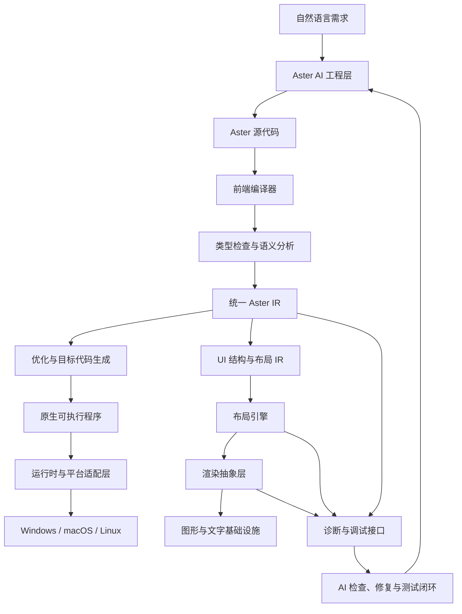

# ASTER-ARCH-001：总体技术架构与关键技术决策

> ADR index: `docs/adr/README.md`

**项目：** Aster  
**文档编号：** ASTER-ARCH-001  
**版本：** V0.1 Draft  
**状态：** 架构方向已确定，关键技术待验证  
**决策范围：** 语言、编译器、UI、渲染、运行时、AI 开发接口、扩展、安全与跨平台

---

## 1. 文档目的

本文确定 Aster 的总体架构、模块边界、关键技术候选方案及选择依据，明确哪些决策现在可以冻结，哪些必须通过原型实验后才能冻结。

Aster 采用 A+C 作为长期设计方向：

- A：自主管理 UI 框架的语义、布局模型、组件模型和开发体验。
- C：采用具有现代视觉表达能力的声明式界面语言，设计可验证、可追踪的样式和布局系统。
- 复用成熟的底层窗口、图形、字体、编译和系统接口基础设施。

这里的“自研 UI”不意味着从零编写 GPU 驱动、字体排版引擎、窗口系统或所有基础控件。Aster 的研发重点应当放在能够产生独特价值的部分。

## 2. 总体架构

### 2.1 架构图



该图描述逻辑关系，不意味着所有模块都必须运行在同一个进程中。编译器、AI 开发工具和最终应用应当在部署上保持分离。

### 2.2 架构分层

| 层 | 职责 | 是否由 Aster 主导设计 |
|---|---|---|
| AI 工程层 | 需求拆解、变更规划、测试执行、诊断处理 | 是 |
| 语言前端 | 词法、语法、类型、模块和语义分析 | 是 |
| 统一 IR | 表达业务逻辑、UI、状态、事件、权限和约束 | 是 |
| 编译器后端 | 机器码生成、优化、链接 | 采用成熟基础设施，保留抽象接口 |
| UI 语义层 | 组件、属性、样式、状态绑定和布局规则 | 是 |
| 布局引擎 | 尺寸测量、约束求解、布局计算 | 由 Aster 定义语义，内部实现可替换 |
| 渲染抽象层 | 绘制命令、裁剪、变换、资源生命周期 | 由 Aster 定义接口，底层复用成熟技术 |
| 平台适配层 | 窗口、输入、菜单、文件对话框、剪贴板 | 优先复用成熟实现 |
| 运行时 | 内存、异步、事件分发、系统能力 | 自主管理接口，复用成熟实现 |
| Studio | 设计器、检查器、调试器和实时预览 | 是 |
| 包与插件系统 | 依赖管理、组件发布、权限与隔离 | 是 |

核心原则：**Aster 必须拥有自己的语义和中间表示，但不需要拥有每一行底层实现代码。**

## 3. 关键技术决策总表

| 编号 | 决策主题 | 当前选择 | 状态 |
|---|---|---|---|
| ADR-001 | 编译器实现语言 | Rust | 暂定采用 |
| ADR-002 | 语言自身是否自举 | 第一阶段不自举 | 已确定 |
| ADR-003 | 代码生成后端 | LLVM 与其他候选通过实验比较 | 待验证 |
| ADR-004 | UI 语义层 | Aster 自主设计 | 已确定 |
| ADR-005 | UI 描述语言 | 自有声明式语法，借鉴 CSS 的视觉表达能力 | 已确定方向 |
| ADR-006 | 布局系统 | Flex、Grid、约束、画布并存 | 已确定方向 |
| ADR-007 | 图形渲染 | 抽象接口，复用成熟图形库 | 待验证 |
| ADR-008 | 窗口与系统接口 | 复用成熟跨平台基础设施，必要时使用原生 API | 已确定方向 |
| ADR-009 | 内存模型 | 优先易理解与可预测性，具体机制待验证 | 待验证 |
| ADR-010 | AI 调试接口 | 稳定、机器可读的结构化协议 | 已确定 |
| ADR-011 | 插件安全 | 编译期库、受控原生扩展、隔离插件分层 | 已确定方向 |
| ADR-012 | 跨平台策略 | 统一语言与 IR，平台后端分别适配 | 已确定 |

---

## 4. ADR-001：编译器采用什么语言实现？

### 候选方案

- Rust：内存安全、类型系统强、适合编译器和系统工具。
- C++：成熟的编译器生态，但实现复杂度和内存安全维护成本较高。
- Go：开发效率较高，但需要评估内存分配、原生互操作和编译器相关生态是否适合目标。

### 决策

**编译器、CLI、包管理器和大部分开发工具优先使用 Rust 实现。**

理由：

1. 编译器内部需要大量结构化数据，Rust 的类型系统有利于明确模块边界。
2. 内存安全能够减少底层工具中的一类常见错误。
3. 适合构建跨平台命令行工具。
4. 不要求 Aster 语言本身继承 Rust 的全部语法和内存管理规则。

### 边界

Rust 是 Aster 工具链的实现语言，不是 Aster 的语言规范。

用户不应为了使用 Aster 而必须学习 Rust。

### 验收

- 在目标开发平台构建编译器。
- 能够解析 Aster 源文件并输出结构化诊断。
- 核心编译流程具有自动化测试。
- 诊断信息能精确定位到文件、行、列和语法节点。

---

## 5. ADR-002：第一版是否需要自举？

### 决策

第一阶段不使用 Aster 编写自己的编译器。

先用 Rust 实现编译器和工具链。等语言、标准库、包管理和调试能力稳定后，再评估是否值得自举。

原因：

- 自举会同时增加语言和编译器两方面的复杂度。
- 初期语法经常变化，自举会使每次语言修改都更昂贵。
- 自举不是衡量语言质量或性能的必要条件。

验收目标是让 Aster 能够可靠编译、运行、检查和维护桌面应用，而不是尽早展示编译器能够编译自己。

---

## 6. ADR-003：编译器后端如何选择？

### 候选方案 A：LLVM

LLVM 提供成熟的目标代码生成与优化基础设施，支持将中间表示转换为多种目标平台的机器码。<https://llvm.org/docs/CodeGenerator.html>

优势：

- 目标架构覆盖广。
- 优化基础设施成熟。
- 适合构建面向多个桌面平台的 AOT 编译器。

风险：

- 工具链集成和构建管理可能较复杂。
- 发行版、静态链接、调试信息和运行时的组合需要额外工程工作。
- 不应假设使用 LLVM 就必然获得最小的可执行文件。

### 候选方案 B：Cranelift 或其他更轻量的代码生成方案

优势：

- 可以评估更简单的集成与迭代工作流。
- 可能适合快速原型或部分开发工具场景。

风险：

- 必须实测目标平台覆盖、优化效果、调试能力与 AOT 发布流程。
- 不能仅凭“更轻量”就断定最终应用更小。

### 决策

第一阶段不将代码生成后端写死在语言规范中。

建立统一的 Aster 后端接口，至少比较：

1. 编译正确性。
2. Windows、macOS、Linux 的目标支持。
3. 冷构建与增量构建时间。
4. 生成程序的大小和运行性能。
5. 调试信息与错误定位。
6. 依赖、构建和发布的复杂度。

实验后再确定首选后端。AOT 是目标方向，具体实现方案以实测结果为准。

---

## 7. ADR-004：为什么 UI 语义必须由 Aster 自己掌握？

### 决策

Aster 必须拥有独立的 UI 语义模型，不能将某个现有框架的 UI 文件格式直接作为 Aster 的规范。

自有语义至少包括：

- 组件定义和组件树。
- 属性、插槽与样式。
- 状态、事件和数据绑定。
- 布局约束与测量规则。
- 可访问性语义。
- 组件依赖和变更影响。
- 调试信息和自动化验证规则。

### 原因

如果 Aster 直接将 UI 语法绑定到某个第三方框架，那么该框架的语法限制、生命周期和数据绑定模型就可能反向限制 Aster。

拥有自己的 UI IR 后，Aster 可以在不改变源语言的前提下替换布局或渲染后端。

但这并不意味着所有语义都必须自行实现。Aster 可以复用已有的布局算法、渲染实现和平台适配，只要适配层能正确实现 Aster 的语义。

---

## 8. ADR-005：如何设计接近 HTML/CSS 的 UI 语言？

### 决策

采用自有声明式 UI 语法，吸收 HTML/CSS 的优势，但不要求与 HTML/CSS 完全兼容。

建议把界面分为三个相互关联的部分：

1. **结构：** 描述组件树和内容。
2. **布局：** 描述尺寸、对齐、间距、约束和响应式行为。
3. **视觉：** 描述颜色、字体、渐变、边框、阴影、动画和主题。

示意：

```text
view MainWindow {
    Column {
        padding: 24
        gap: 16

        Text("文件管理器") {
            style: heading
        }

        Row {
            width: fill
            gap: 12

            SearchBox {
                width: fill
                placeholder: "搜索文件"
            }

            Button("搜索") {
                id: search_button
            }
        }
    }
}
```

上述代码只是架构示意，不是已冻结的正式语法。

### 样式规则要求

- 组件属性有明确类型。
- 样式的来源和优先级可追踪。
- 不使用难以预测的全局样式覆盖。
- 支持设计令牌与局部自定义样式。
- 支持自定义绘制和复杂视觉效果。
- 样式变化可以触发局部更新。

### 待验证问题

需要确认 Aster 的样式语言能否在保持设计自由的同时，让 AI 更容易正确修改界面，并减少意外的连锁变化。

---

## 9. ADR-006：布局引擎采用什么模型？

### 决策

采用多种布局模型并存，而不是强制整个界面使用一种布局算法。

| 布局模式 | 适用场景 |
|---|---|
| Flex / Row / Column | 表单、工具栏、普通内容区 |
| Grid | 仪表盘、卡片网格、复杂数据区域 |
| Constraint / Anchor | 精确对齐、受约束尺寸、特殊窗口布局 |
| Stack / Overlay | 弹层、浮动按钮、重叠元素 |
| Canvas / Absolute | 绘图软件、时间线、节点编辑器、自由画布 |

普通应用优先使用流式和约束布局；绝对定位允许存在，但不应成为默认方案。

### 核心要求

布局引擎必须能够解释：

- 每个组件的最终坐标与尺寸。
- 每个尺寸的来源。
- 可用空间如何分配。
- 哪些约束被满足或违反。
- 溢出和重叠是如何产生的。

不能只返回一张最终图片。

### 待验证问题

- 如何处理最小尺寸、最大尺寸与内容测量？
- 如何避免约束冲突？
- 如何兼顾布局精度与运行效率？
- 如何在不同 DPI、字体和窗口尺寸下保持稳定？

---

## 10. ADR-007：图形渲染如何实现？

### 候选方案

**Skia：** 成熟的跨平台 2D 图形库，支持多种绘图能力和硬件后端。官方资料说明它用于 Chrome、Flutter 等多个产品。<https://skia.org/docs/>

优势是绘图能力成熟；风险是引入的依赖和构建配置可能影响最终发行包体积。Slint 文档也指出，其 Skia 渲染器相较部分其他渲染器具有更大的磁盘占用。<https://docs.slint.dev/latest/docs/slint/guide/backends-and-renderers/backends_and_renderers/>

**WGPU 生态及相关渲染器：** 适合评估现代 GPU 绘制能力，但仍需验证文字排版、普通控件、软件回退和不同平台驱动的表现。

**平台原生绘图 API：** 可以充分利用系统能力，但跨平台一致性和实现维护成本需要谨慎评估。

### 决策

Aster 定义独立的渲染抽象层，第一版通过实验选择底层实现。

不直接承诺所有界面必须使用 Skia、WGPU 或某个单一引擎。

渲染层需要支持：

- 形状、路径、图片与变换。
- 裁剪、透明度、渐变和阴影。
- 文字绘制与高质量排版。
- 局部重绘。
- GPU 渲染与适当的软件回退。
- 高 DPI 与色彩管理。
- 绘制性能诊断。

**特别要求：中文排版、输入法、字体回退和复杂文字布局必须纳入早期测试。** 这些不是最后才处理的边缘功能。

---

## 11. ADR-008：窗口和操作系统接口

### 决策

优先复用成熟的跨平台窗口和事件循环基础设施，必要时针对平台提供原生适配。

Aster 应统一定义以下接口：

- 窗口创建、关闭、调整大小与焦点管理。
- 鼠标、触控板、键盘和滚轮事件。
- 高 DPI 与显示器变化通知。
- 文件打开、保存和目录选择。
- 剪贴板、菜单和快捷键。
- 系统托盘和通知。
- 输入法与无障碍接口。

不在第一阶段为每个操作系统重写整个窗口系统。

需要单独验证的是：底层跨平台库能否满足 Aster 的窗口生命周期、输入法、原生菜单和调试要求。若不能满足，使用局部平台适配，而不是直接推翻整个架构。

---

## 12. ADR-009：运行时与内存模型

### 决策方向

Aster 应优先选择对 AI 和普通开发者容易理解、运行行为可预测的内存模型。

不直接复制 C++ 的手动内存管理复杂度，也不在没有实验的情况下引入完整垃圾回收器。

待比较的方案包括：

- 值类型与显式所有权。
- 引用计数与自动资源释放。
- 对象所有权与生命周期规则。
- 对特定性能敏感路径提供受控的低层能力。

运行时需要明确区分：

- UI 线程与后台任务。
- 异步任务与同步调用。
- 状态更新与副作用。
- 资源所有权与释放时机。
- 取消任务与关闭窗口时的清理行为。

最终选择应同时考虑 AI 生成代码的正确率、内存占用、性能、调试难度和 FFI 安全性。

---

## 13. ADR-010：AI 工具接口与诊断协议

### 决策

AI 开发工具必须通过稳定、机器可读的接口获取程序信息，不依赖解析终端输出或猜测源码结构。

初始 CLI 规划：

```text
aster check
aster build
aster run
aster test
aster inspect tree
aster inspect layout
aster inspect state
aster inspect events
aster diagnose
```

接口应能提供：

- 语法树和类型信息。
- 组件树及组件属性。
- 运行时布局结果。
- 状态快照和事件时间线。
- 编译、布局和运行错误。
- 自动化测试结果。
- 修改前后的差异信息。

结构化诊断至少包括错误码、级别、源位置、相关组件、实际值、预期值和可行的修复建议。

AI 修改程序后，工具链应自动执行必要的检查和测试。未通过验收时，不应把修改标记为成功。

---

## 14. ADR-011：第三方扩展与安全边界

### 决策

采用三种扩展机制。

**第一类：普通库**

编译期依赖，适合基础函数、数据处理和可复用业务逻辑。

**第二类：原生扩展**

用于需要高性能或系统互操作的模块。需要稳定的 ABI、版本兼容规则和明确的信任边界。

**第三类：隔离插件**

用于来源不完全可信、需要独立升级或应限制权限的扩展。优先考虑独立进程或经过验证的沙箱机制。

不能将同进程原生插件视为安全沙箱。插件若能直接访问宿主进程的内存，就可能破坏宿主应用的安全边界。

### 包管理必须支持

- 版本锁定。
- 依赖来源与完整性验证。
- 许可证检查。
- 已知漏洞检查。
- 插件权限声明。
- 可审计的发布与升级过程。

---

## 15. ADR-012：跨平台策略

### 决策

语言、标准库、UI 语义和大部分业务逻辑尽可能共享；平台特有行为通过适配层实现。

目标平台：

- Windows
- macOS
- Linux

第一版应明确支持的 CPU 架构和最低系统版本，不把“理论上能编译”视为正式支持。

跨平台测试必须覆盖：

- 窗口和事件。
- 中文输入法。
- 字体回退。
- DPI 和显示器变化。
- 文件路径和权限。
- 菜单与快捷键。
- 应用打包与签名。
- 无障碍与键盘操作。

如果某个功能无法在所有平台保持完全相同的行为，必须在标准库中明确记录平台差异。

---

## 16. 构建、发行与依赖管理

### 决策

开发工具与最终发行应用分开构建。

开发环境可以使用较完整的诊断工具和调试设施；发行应用则只包含实际需要的运行时、资源和依赖。

发行流程应包括：

1. 解析并锁定依赖。
2. 检查依赖来源与许可证。
3. 编译目标平台代码。
4. 执行自动化测试。
5. 进行必要的链接优化与死代码删除。
6. 生成应用包。
7. 执行发布前安全检查。
8. 签名并记录构建信息。

包体积优化必须基于真实构建结果，不通过删除必要的国际化、输入法或安全能力来制造虚假的轻量指标。

---

## 17. 关键技术验证实验

在冻结最终架构之前，必须先完成下列实验。

### EXP-001：原生应用基准

实现最小窗口、按钮、文本和简单状态更新。

比较不同后端的：

- 构建复杂度。
- 可执行文件体积。
- 运行时依赖。
- 冷启动时间。
- 空闲内存。
- 跨平台可行性。

**通过条件：** 能够建立可重复的基准构建流程，记录真实数据与构建配置。

### EXP-002：复杂布局验证

实现表单、侧边栏、可调整分割面板、响应式网格和弹层。

测试：

- 窗口缩放。
- 最小尺寸和最大尺寸。
- 长文本与中文字体。
- 不同 DPI。
- 溢出、重叠和裁切。
- 字体加载失败与回退。

**通过条件：** 布局错误能够被自动检测，并提供可追踪的原因。

### EXP-003：A+C 与 Slint 的对照实验

用同一份需求分别实现两个原型：

- 原型 A：Aster 自有 UI 语义与 IR，连接候选渲染后端。
- 原型 B：基于 Slint 构建相同界面和交互。

比较开发时间、功能完整性、依赖、体积、内存、调试能力与 AI 可修改性。

**通过条件：** 得到可重复的实验记录，明确 Slint 哪些能力可直接复用、哪些需求需要自研。

### EXP-004：AI 自动修复闭环

设计一组包含布局错误、类型错误、状态错误和事件处理错误的任务。

让 AI 完成：

1. 读取项目。
2. 识别问题。
3. 修改代码。
4. 编译和运行。
5. 读取诊断。
6. 修复并执行测试。

**通过条件：** 每次任务都有成功率、修复次数、耗时和回归缺陷记录；不能只挑成功案例。

### EXP-005：中文与输入法验证

测试中文输入法候选窗口、组合输入、删除、光标移动、复制粘贴、字体回退和混合文字排版。

**通过条件：** 在目标平台上完成基本中文编辑流程，不能因界面自绘而破坏输入法交互。

### EXP-006：代码生成后端对比

比较 LLVM 与至少一个合理的替代候选，使用相同的程序和构建条件。

**通过条件：** 确定目标平台覆盖、调试信息、构建成本、程序体积和运行性能的实际差异。

### EXP-007：插件安全原型

实现一个普通库和一个隔离插件，测试权限限制、异常退出、版本不匹配与依赖升级。

**通过条件：** 明确哪些故障可以被隔离，哪些能力必须由操作系统或可信沙箱提供。

### EXP-008：第三方组件开发流程

由独立示例项目开发一个自定义组件包，完成构建、测试、版本锁定和发布。

**通过条件：** 第三方无需修改 Aster 编译器源码即可开发并使用组件。

---

## 18. 实验执行顺序

| 顺序 | 实验 | 目的 |
|---|---|---|
| 1 | EXP-001 原生应用基准 | 先确认最小应用的真实成本 |
| 2 | EXP-003 A+C 与 Slint 对照 | 验证自研边界是否合理 |
| 3 | EXP-002 复杂布局 | 验证 UI 语义和布局模型 |
| 4 | EXP-005 中文与输入法 | 提前排除关键平台风险 |
| 5 | EXP-004 AI 修复闭环 | 验证项目最重要的差异化能力 |
| 6 | EXP-006 代码生成后端 | 冻结编译器后端 |
| 7 | EXP-007 插件安全 | 验证扩展隔离模型 |
| 8 | EXP-008 第三方组件 | 验证生态开发路径 |

前四项可以先形成原型，不需要等待完整语言实现。AI 闭环实验可以先使用受限的结构化模型验证，随后随着编译器成熟逐步替换为真实实现。

---

## 19. 架构冻结条件

只有满足以下条件，才能将 V0.1 架构从 Draft 转为冻结版本：

- [ ] 编译器实现语言和构建方案可用。
- [ ] UI 语义与底层渲染之间存在明确边界。
- [ ] 至少一个原生应用基准可重复构建。
- [ ] 布局模型能够处理基本复杂场景。
- [ ] 中文输入与字体方案经过验证。
- [ ] AI 能够通过结构化接口读取诊断。
- [ ] 代码生成后端的选择有实验数据支持。
- [ ] 第三方扩展的信任边界已经明确。
- [ ] 依赖许可证和发行流程不存在未解决的关键障碍。
- [ ] 已记录关键未决问题及后续决策责任。

架构冻结不代表以后不能修改，而是任何重大修改都必须通过正式的架构决策记录说明理由、影响范围和迁移方案。

---

## 20. 本阶段结论

Aster 采用 A+C 作为长期架构方向：自主管理 AI 友好的语言、UI 语义、布局规则和诊断协议，同时复用成熟的底层技术。

当前不提前锁定某个渲染器或代码生成后端。Slint 是重要的对照对象，但不是 Aster 的语言规范。

接下来的实际工作应当从 EXP-001 与 EXP-003 开始：建立最小原生应用基准，并用相同需求比较自有 UI 语义方案与成熟框架方案。

只有当实验说明自研部分确实带来足够的 AI 可修改性、可观测性或设计自由优势时，才继续扩大自研范围。

**项目优先级：先验证架构，再冻结接口；先完成最小闭环，再扩展语言与生态。**